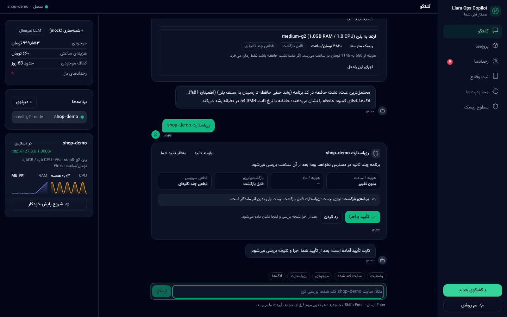
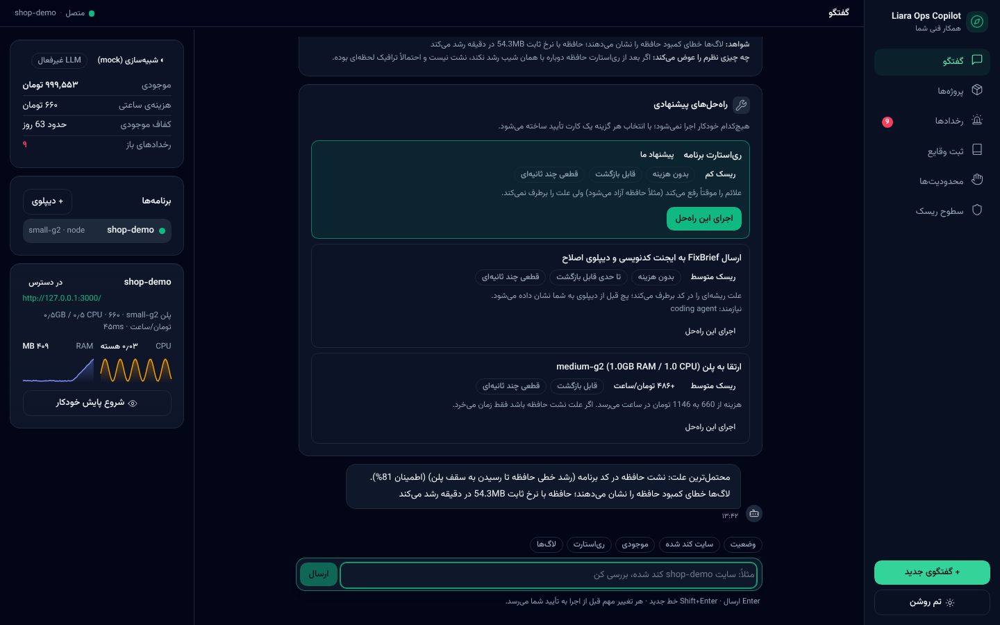
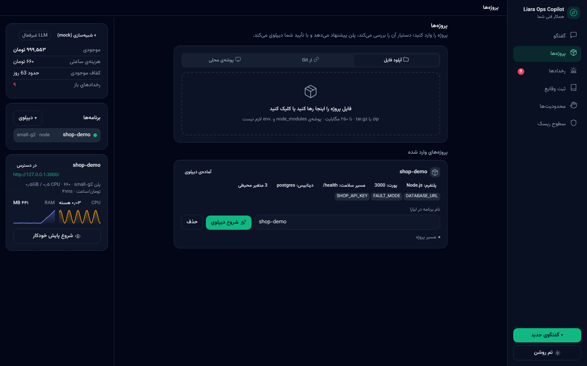
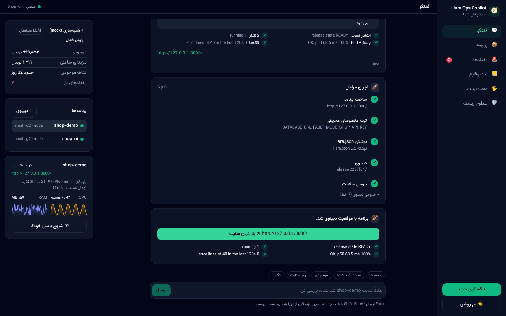

<div align="center">

# Liara Ops Copilot

**همکار فنیِ صاحب سایت روی ابر لیارا: از اولین دیپلوی تا پایش، تشخیص و رفع مشکل، همیشه با تأیید انسان برای کارهای حساس.**

[اسلایدهای ارائه](docs/slides.html) · [معماری](docs/ARCHITECTURE.md) · [محدودیت‌ها](docs/LIMITATIONS.md) · [سناریوی دمو](docs/DEMO_SCRIPT.md)

`Python 3.11+` · `FastAPI` · `React + Vite` · `MCP` · `SQLite` · `API های رسمی لیارا`

</div>

---

## مسئله

لیارا دیپلوی را ساده کرده، اما هنوز چرخه‌ی شارژ حساب، انتخاب پلن، آپلود، متغیرهای محیطی، دامنه و بعد از آن پایش و عیب‌یابی را خودِ صاحب سایت باید بلد باشد. چالش این است: یک ایجنت که این چرخه را به یک گفتگوی ساده تبدیل کند، کارهای کم‌ریسک را خودش انجام دهد، برای کارهای حساس تأیید بگیرد، وقتی سایت کند شد لاگ و متریک را بخواند و علت را پیدا کند، و هر جا API لیارا کم می‌آورد صادقانه بگوید.

## راهکار در یک جمله

```
پیشنهاد (LLM یا قواعد)  →  تأیید انسان  →  اجرا (کدِ قطعی روی API واقعی)  →  بررسی نتیجه  →  ثبت در audit
```

**مدل هیچ‌وقت چیزی را اجرا نمی‌کند.** هر ابزار با یک سطح ریسک ثبت شده (T0 خواندن، T1 نوشتن کم‌ریسک، T2 نیازمند تأیید، T3 محافظت‌شده) و ابزارهای T2 فقط یک «کارت تأیید» می‌سازند. تشخیص مشکل شواهدمحور است: اعداد، خطوط لاگ، درصد اطمینان و «چه چیزی نظرم را عوض می‌کند». و بدون کلید LLM هم همه‌ی جریان‌ها کار می‌کنند؛ LLM فقط توضیح، گفتگوی آزاد و بازرتبه‌بندی فرضیه‌ها را بهتر می‌کند.

## چه می‌بینید

| دیپلوی با تأیید | تشخیص نشت حافظه |
|---|---|
|  |  |
| **ورود پروژه داخل برنامه** | **stepper زنده و کارت موفقیت** |
|  |  |

## قابلیت‌ها در برابر معیارهای داوری

**یکپارچه‌سازی با لیارا (۱۰۰)**
- ورود پروژه از داخل برنامه: آپلود zip/tar.gz با drag-and-drop، کلون Git، یا پوشه‌ی محلی؛ تحلیل خودکار پلتفرم، پورت، متغیرها و دیتابیس.
- پیشنهاد پلن از کاتالوگ زنده‌ی `/v1/me` با هزینه‌ی ساعتی/ماهانه و «زمان باقی‌مانده‌ی موجودی»؛ هیچ قیمتی hard-code نیست.
- ساخت برنامه (با `bundlePlanID`)، ثبت متغیرها، نوشتن `liara.json`، دیپلوی با CLI رسمی یا API خام (`sources` + `releases`)، دنبال کردن release تا `READY`، بررسی HTTP و لاگ.
- عملیات روزمره به‌صورت proposal: ری‌استارت، روشن/خاموش، متغیر محیطی، تغییر پلن، دامنه و SSL، رکوردهای DNS.

**هوشمندی و حل مسئله (۱۰۰)**
- جمع‌آوری موازی لاگ، رویداد، متریک CPU/RAM، release ها، applets و probe مستقیم HTTP.
- تحلیل‌گرهای قطعی: نشت حافظه (شیب + یکنواختی روی پنجره‌ی اخیر)، اشباع CPU/RAM نسبت به سقف پلن، OOM و crash loop، خوشه‌بندی خطاها با استخراج stack trace، رگرسیون تأخیر، همبستگی با آخرین release.
- فرضیه‌های رتبه‌بندی‌شده با اطمینان و «شواهد مخالف»، گزینه‌های رفع با ریسک/هزینه/برگشت‌پذیری (rollback، ری‌استارت، ارتقا، اصلاح تنظیمات، اصلاح کد)، و بررسی نتیجه با مقایسه‌ی قبل/بعد.
- پل ایجنت کدنویسی: FixBrief ساخت‌یافته، اجرای ایجنت یا پچ قطعی دمو، اعمال پچ و دیپلوی فقط با تأیید.

**تجربه کاربری (۵۰)**
- گفتگو به زبان ساده + کارت‌های تایپ‌شده: تحلیل پروژه، گزینه‌های پلن، فرم متغیرها (پیش‌پر از `.env`)، کارت تأیید با اثر هزینه/قطعی/بازگشت، stepper زنده، نمودار شواهد، فرضیه‌ها، راه‌حل‌ها، مراحل دستی با دکمه‌ی «انجام شد».
- پنل وضعیت زنده: موجودی و runway، سلامت برنامه‌ها، sparkline حافظه/CPU، Watcher.
- RTL فارسی، فونت Vazirmatn self-host، تم تیره/روشن، موبایل.

**پایداری، نگهداری و امنیت (۵۰)**
- Watcher با قواعد آستانه، شیب و z-score که خودش incident باز می‌کند و بررسی read-only را اجرا می‌کند (لیارا webhook ندارد).
- allowlist برنامه، cost guard، dry-run، توکن تأیید HMAC یک‌بارمصرف که از مسیر MCP/مدل قابل‌دسترسی نیست، audit فقط‌افزودنی، ماسک کردن اسرار قبل از لاگ و LLM.
- رجیستری محدودیت‌های API به‌صورت کارت‌های مرحله‌ی دستی ([docs/LIMITATIONS.md](docs/LIMITATIONS.md)).

## معماری

```
┌──────────────── Interfaces ────────────────┐     ┌──────────── Orchestrator (FastAPI) ────────────┐
│ Web UI (React, RTL, SSE)  ·  CLI  ·  MCP   │◄───►│ Agent loop: keyword router → LLM router → tools │
└────────────────────────────────────────────┘     │ State machines: DeployWizard · Investigator ·   │
                                                   │                 Watcher                         │
                                                   └───────┬────────────────┬────────────┬──────────┘
         ┌─────────────────────────────────────────────────┤                │            │
         ▼                                                 ▼                ▼            ▼
┌────────────────────┐  ┌────────────────────────────┐  ┌──────────────┐  ┌─────────────────┐
│ Policy engine      │  │ Capability modules         │  │ LLM gateway  │  │ Store (SQLite)  │
│ T0/T1/T2/T3 tiers  │  │ LiaraClient · Deploy       │  │ BoxAPI       │  │ timeline        │
│ allowlist · cost   │  │ SRE toolkit · Watcher      │  │ strong/small │  │ proposals       │
│ guard · dry-run    │  │ CodingAgentBridge          │  │ tools / JSON │  │ audit · incidents│
│ HMAC approvals     │  │ Knowledge (limits + RAG)   │  │ protocol     │  │ snapshots       │
└────────────────────┘  └─────────────┬──────────────┘  └──────────────┘  └─────────────────┘
                                      ▼
                     api.liara.ir · dns-service.liara.ir   (یا tools/mock_liara)
```

جزئیات، تعریف‌های verification و فهرست فکت‌های VERIFIED/ASSUMED درباره‌ی API لیارا: [docs/ARCHITECTURE.md](docs/ARCHITECTURE.md). اسلایدهای ارائه (صورت‌مسئله و خلاصه‌ی گرافیکی): [docs/slides.html](docs/slides.html).

## اتصال به API های لیارا

| چه چیزی | چطور | وضعیت |
|---|---|---|
| احراز هویت و تیم | `Authorization: Bearer <JWT>` · query `teamID` (روش CLI رسمی) | VERIFIED |
| حساب، کاتالوگ پلن، موجودی تیم | `GET /v1/me` → `plans.projects[planID]` (`RAM.amount`, `CPU.amount`, `price` ساعتی), `team.balance` | VERIFIED روی حساب واقعی |
| موجودی شخصی | `GET /v1/billing` → `user.balance` | VERIFIED |
| برنامه‌ها | `GET/POST /v1/projects` (+`bundlePlanID`), `GET /v1/projects/{name}` | VERIFIED |
| اجرا/توقف/ری‌استارت/پلن/متغیرها | `.../actions/scale`, `.../actions/restart`, `.../resize`, `/v1/projects/update-envs` | VERIFIED |
| دیپلوی | `liara deploy` یا `POST /v2/projects/{name}/sources` (tar.gz) + `POST /v2/projects/{name}/releases` → `GET /v1/releases/{id}` تا `READY` | VERIFIED |
| مشاهده‌پذیری | `.../logs?since=` (unix s), `.../events`, `.../releases`, `.../metrics/{cpu,memory}` (۳۰ ثانیه، هسته/بایت) | VERIFIED روی حساب واقعی |
| applets | `.../applets` (برای برخی برنامه‌های docker از سمت لیارا 500 می‌دهد؛ غیرمهلک) | VERIFIED |
| دامنه و DNS | `/v1/domains`, `/v1/domains/{id}/check`, `provision-ssl-certs`, `dns-service.liara.ir/api/v1/zones` | VERIFIED |

کلاینت (`backend/app/liara/client.py`): throttle، retry با backoff نمایی، circuit breaker، خطاهای فارسی، ماسک کردن توکن و مقادیر حساس، ضبط fixture. `tools/probe.py` همه‌ی فرضیات را فقط با GET روی حساب واقعی چک می‌کند و خروجی ماسک‌شده می‌دهد.

## اجرا

**پیش‌نیاز**: Python 3.11+، Node 18+، `uv` (یا pip)؛ برای دیپلوی واقعی `npm i -g @liara/cli`.

```bash
cp .env.example .env          # LIARA_API_TOKEN، BOXAPI_API_KEY (اختیاری)، COPILOT_MODE=mock|live
make setup && make dev-up     # mock لیارا :8081 · اپ نمونه :3000 · backend :8000
make frontend                 # http://localhost:5173
```

ویندوز: `cd backend; uv venv .venv; uv pip install -p .venv\Scripts\python.exe -e ".[dev]"` سپس از ریشه `.\scripts\dev_up.ps1`.

- **mock** (پیش‌فرض): بدون توکن؛ شکل واقعی پاسخ‌ها + سناریوهای خطا:
  `curl -X POST localhost:8081/__mock/scenario -H 'content-type: application/json' -d '{"app":"shop-demo","scenario":"memory_leak","minutes_ago":4}'`
- **live**: `COPILOT_MODE=live` و توکن در `.env`؛ `COPILOT_APP_ALLOWLIST` برای محدود کردن دسترسی ایجنت؛ `COPILOT_DRY_RUN=true` برای شبیه‌سازی اجرا.
- **LLM**: `python tools/llm_bench.py` مدل‌ها را می‌سنجد؛ روی BoxAPI `gpt-6-luna` (قوی) و `gpt-5.4-mini` (کوچک) tool calling و JSON را پشتیبانی می‌کنند.
- **MCP**: `claude mcp add liara-ops -- backend/.venv/bin/python -m app.mcp_server`
- **تست و lint**: `make test` (۱۹ تست: سیاست و تأیید، تحلیل‌گرها، analyzer پروژه، API end-to-end روی mock) · `make lint`.

## نحوه‌ی تعامل کاربر

1. پروژه را از تب «پروژه‌ها» وارد کنید (یا در چت بنویسید «دیپلوی ./مسیر»).
2. کارت تحلیل و گزینه‌های پلن را ببینید، متغیرها را تأیید کنید، کارت تأیید را بزنید؛ stepper و کارت موفقیت با آدرس می‌آید و Watcher شروع می‌شود.
3. هر زمان: «وضعیت»، «سایت کند شده»، «ری‌استارت»، «KEY=value»، «ارتقا به medium-g2»، «دامنه example.ir». کارهای حساس همیشه کارت تأیید دارند.
4. وقتی Watcher چیزی دید، incident باز می‌شود: شواهد، فرضیه‌ها، راه‌حل‌ها؛ شما انتخاب و تأیید می‌کنید، نتیجه بررسی می‌شود.

## محدودیت‌ها

API لیارا نمی‌تواند حساب را شارژ کند، توکن بسازد، GitHub را وصل کند، نیم‌سرور ثبت‌کننده را عوض کند یا هشدار/webhook بدهد؛ توکن‌ها scope ندارند. هر کدام در محصول یک کارت مرحله‌ی دستی با دستور دقیق و دکمه‌ی «انجام شد» است. فهرست کامل: [docs/LIMITATIONS.md](docs/LIMITATIONS.md).

## ساختار مخزن

```
backend/app/   api/ agent/ policy/ liara/ deploy/ sre/ watcher/ bridge/ knowledge/ llm/ store/ mcp_server.py cli.py
frontend/      React + Vite + Tailwind (RTL، آیکون‌های SVG، فونت self-host)
tools/         probe.py · llm_bench.py · loadgen.py · mock_liara/
demo/shop-demo اپ Express با FAULT_MODE (leak/slow/error) و پچ قطعی برای دمو
docs/          slides.html · ARCHITECTURE.md · LIMITATIONS.md · DEMO_SCRIPT.md · screenshots/
scripts/       dev_up.sh · dev_up.ps1
```
